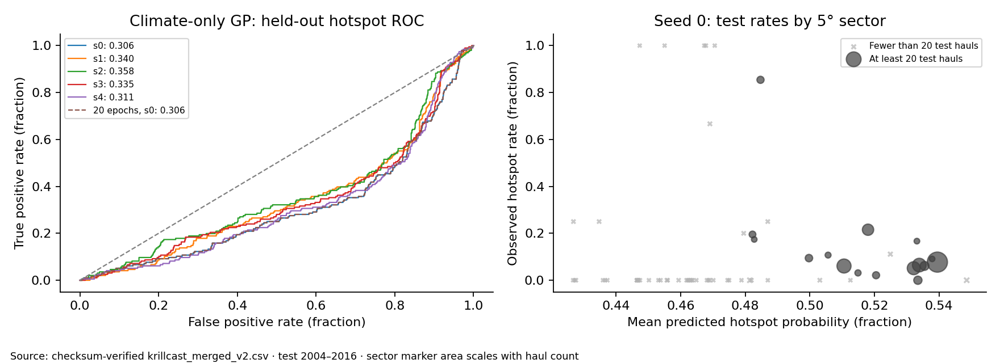

# Corrected-v2 benchmark and reversed climate-only hotspot rankings

- **Date:** 2026-11-15 (America/New_York)
- **Author:** Codex-assisted local analysis
- **Base commit:** `1df79d632ca11292008ff1458bbb8cc2583a71db`
- **Branch:** `analysis/v2-benchmark-hotspots`, created from freshly fetched `origin/main`; excludes PR #42.
- **Question:** Do the documented GP variants beat the existing baselines after correcting climate/haul longitude matching, and does the climate-only hotspot-ranking reversal persist?

## Results

Completed the documented 15-run CPU protocol (three GP variants × five seeds × 30 epochs).
RMSE is in **log1p(krill/m²)** units, not raw abundance. Skill is percentage RMSE reduction
relative to the training-mean constant; brackets give 95% year-block bootstrap intervals.
PR-AUC is average precision, as in the existing benchmark. Random PR-AUC is **0.104145**.
The full 24-row table includes individual seeds and PR-AUC intervals:
[benchmark CSV](2026-11-15-v2-benchmark-table.csv).

| Model | RMSE | Skill % [95% CI] | ROC-AUC | PR-AUC | PR / random |
| --- | ---: | ---: | ---: | ---: | ---: |
| Constant (train mean) | 1.283 | 0.00 [0.00, 0.00] | — | — | — |
| CatBoost, climate only | 1.269 | 1.11 [-1.34, 2.84] | 0.629 | 0.140 | 1.34 |
| Sector climatology | 1.292 | -0.70 [-5.44, 2.69] | 0.639 | 0.261 | 2.50 |
| Climate-only GP (5-seed ensemble) | 1.306 | -1.80 [-4.07, -0.25] | 0.329 | 0.079 | 0.76 |
| CatBoost, climate + recent krill | 1.217 | 5.16 [2.61, 7.65] | 0.561 | 0.127 | 1.21 |
| Latent-state GP (5-seed ensemble) | 1.226 | 4.45 [1.46, 6.93] | 0.647 | 0.190 | 1.83 |
| Autoregressive GP (5-seed ensemble) | 1.251 | 2.50 [1.23, 3.68] | 0.333 | 0.075 | 0.72 |
| Persistence (mean of last 3) | 1.326 | -3.31 [-7.65, 1.50] | 0.624 | 0.176 | 1.69 |
| Persistence (last haul in sector) | 1.584 | -23.41 [-28.47, -17.20] | 0.618 | 0.185 | 1.78 |

**Density:** both catch-history GP ensembles beat the constant with intervals above zero,
and beat sector climatology and both persistence baselines by point RMSE. They also beat
climate-only CatBoost by point RMSE, but neither beats CatBoost with recent krill.
The climate-only GP is worse than the constant (its skill interval is entirely negative),
sector climatology, and climate-only CatBoost; it only beats the persistence baselines
by point RMSE. Comparisons other than skill versus the constant are point comparisons,
not paired significance tests. The nowcast and climate tracks answer different questions.

**Hotspots:** sector climatology has the highest PR-AUC (0.261). The latent-state ensemble
has PR-AUC 0.190, better than the other scored baselines by point estimate except sector
climatology. Both other GP ensembles score below random PR-AUC. No climate-track model
passes the notebook's combined bar of positive density-skill lower bound and PR-AUC at
least twice prevalence: sector climatology passes only the PR criterion, climate-only
CatBoost passes neither, and the climate-only GP fails both. This supports no climate-driven
forecast-skill claim from this experiment.

## Dataset and protocol

Used only `data/krillcast_merged_v2.csv`, SHA-256
`740eeba5a1d3162aeb92ec30a3145fad3ed5bfc67c42141583e9f175455cc7fa`.
No v1 artifacts were reused. The file contains the expected 12 columns and 12,544 hauls,
1926-03-03 through 2016-02-08, with longitudes -179.8167 through 179.75 degrees.
Dates and fractional years agree to floating-point precision; coordinates, dates, and targets
are complete; there are no negative catches.

The unchanged quantile-based chronological split gives 8,766 training hauls
(1926-03-03–1998-02-01), 1,896 validation hauls (1998-02-02–2004-01-28), and 1,882 test hauls
(2004-01-29–2016-02-08). The validation/test fractions remain 0.15 each, including the
existing boundary dates; no new calendar cutoffs were imposed. Test has 196 hotspots
(10.4145%) across 13 years. Training has 815 hotspots; validation has 159.

Protocol sources: `jobs/benchmark.sbatch`, `CONTRIBUTING.md`, `analysis/experiments/TEMPLATE.md`,
`docs/CHANGES_preprocessing_v2.md`, `docs/week1_issues.md`, `scripts/tasks.json`, and
`notebooks/02_benchmark_results.ipynb`. Three GP variants use seeds **0, 1, 2, 3, 4**,
**30 epochs** each and the training CLI defaults: 500 inducing points, hidden dimension 64,
batch size 256, Adam learning rate 0.001, weight decay 0.0001, classification weight 1,
kernel jitter 0.001, polar coordinates, lag steps 1/3/1, latent-state width 8,
validation-RMSE checkpoint/scheduler monitoring, scheduler patience 5/factor 0.5/minimum
learning rate 0.00001, and 41 validation F1 thresholds (0.05–0.95). Evaluation and threshold
tuning occur every epoch; loaders use zero workers; compilation is off. Inducing initialization uses training-only KMeans with random state 42 and 10 initializations,
unchanged across training seeds. Settings were fixed before examining test results. The starter job's seed loop does not yet pass `--seed`;
these commands pass it explicitly.

`benchmark_skill.py` supplies the unchanged constant, sector-climatology, last-haul and
last-three-haul persistence baselines, plus climate-only and catch-history CatBoost models.
CatBoost keeps the script's seed 0, 2,000 maximum iterations, depth 6, learning rate 0.03,
validation early stopping (100 iterations), and balanced classification weights. Year-block
bootstrap uses 1,000 draws and seed 0. Ensemble rows average predictions across five seeds;
they are not arithmetic averages of per-seed metrics. Bootstrap intervals describe
held-out-year uncertainty, not uncertainty over training seeds.

### Necessary correctness fixes before scientific runs

1. **Explicit benchmark dataset:** `gp_test_predictions` previously called
   `load_trained_fishcast` without a data path, silently defaulting to `data/krillcast_merged.csv`
   even when the benchmark received `--data ...v2.csv`. It now forwards `args.data`.
   A focused regression test checks both the path and selected row positions.
2. **CPU best-checkpoint snapshots:** `detach().cpu()` shares tensor storage with an already-CPU
   model. Later optimizer steps mutated the purported best checkpoint. A two-epoch synthetic
   regression test forced epoch 1 to be validation-best and failed before the fix: its saved
   parameters had changed by epoch 2. Snapshot tensors now additionally use `.clone()`.
   This restores the documented validation-selected checkpoint; it does not change the loss,
   optimizer, model architecture, splits, preprocessing, labels, or baseline definitions.

All benchmark models were trained after these fixes. The base commit alone is therefore
insufficient provenance: the local source patch and source SHA-256 manifest accompany the runs.
The one-epoch smoke run predates the snapshot fix, which has no effect for one epoch; it is
excluded from the scientific comparison.

### Missingness and longitude checks

Raw missing counts: SST/SIA/SIM/SSS **692 each**, SIT **11,861**, SAP/SLP **98 each**.
These are v2 counts, not the older counts quoted in the preprocessing-change note.
The existing sea-ice rule changes **10,538** blank SIT entries with SIA=0 to zero; **1,323**
SIT entries remain missing (631 with observed ice, 692 with SIA also missing).
Training-fitted imputation and scaling produce finite tensors; the missing-pattern features
are `SST_MISSING`, `SIT_MISSING`, and `SAP_MISSING`. Non-indicator training feature means are
approximately zero. The independent hotspot reconstruction matches the loader exactly:
training-sector 90th percentile, fallback to the overall training cutoff **14.32173931**
krill/m² for sectors with fewer than 20 training hauls, and a positive catch requirement.
No empty haul is a hotspot. Targets match `log1p(raw catch)` and lag-enriched row order
matches dates and coordinates.

The matching code converts west longitudes to 0–360 before nearest-grid lookup
(e.g. -60° → 300°); training retains -180–180 and projects to the polar plane.
A targeted old-bug signature check found identical SST in **0/157 western** and **0/25 eastern**
date/latitude-grid groups spanning at least three distinct longitude-grid cells with complete
SST. Co-located hauls within a single grid cell can legitimately share SST. This supports
removal of the old longitude-column collapse but is not an independent reconstruction of
CMIP6 matching: original grids and matching provenance are not available locally. Historical
through 2014 / SSP2-4.5 in 2015–2016 is documented provenance, not independently reverified
from NetCDF sources.

## Reproduction commands

Run from the repository root with this branch's uncommitted fixes applied. The actual run's
absolute command lines, working directories, per-job times and return codes are saved in
`artifacts/v2_benchmark_2026-11-15/provenance.json`.

```bash
export PATH=/opt/anaconda3/envs/fishcast/bin:$PATH
export CONDA_PREFIX=/opt/anaconda3/envs/fishcast CONDA_DEFAULT_ENV=fishcast
python --version
shasum -a 256 data/krillcast_merged_v2.csv
python -m pytest -q
python -m ruff check .

ROOT="$PWD"
DATA="$ROOT/data/krillcast_merged_v2.csv"
OUT="$ROOT/artifacts/v2_benchmark_reproduction"
mkdir -p "$OUT"

# Exploratory smoke only, excluded from final table.
python scripts/train_fishcast.py --data "$DATA" \
  --model-type climate_conditioned_gp --device cpu --epochs 1 --seed 0 \
  --output-dir "$OUT/smoke"
(
  cd "$OUT"
  python "$ROOT/scripts/benchmark_skill.py" --data "$DATA" \
    --gp-runs "$OUT/smoke" --output "$OUT/smoke_benchmark" --bootstrap 10
)

RUNS=()
for model in climate_conditioned_gp autoregressive_gp latent_state_augmented_gp; do
  for seed in 0 1 2 3 4; do
    run="$OUT/runs/${model}_s${seed}"
    python scripts/train_fishcast.py --data "$DATA" --model-type "$model" \
      --device cpu --epochs 30 --seed "$seed" --output-dir "$run"
    RUNS+=("$run")
  done
done
(
  cd "$OUT"  # Keep CatBoost's generated logs with the raw artifacts.
  python "$ROOT/scripts/benchmark_skill.py" --data "$DATA" \
    --gp-runs "${RUNS[@]}" --output "$OUT" --bootstrap 1000
)

# Separate, prespecified 20-epoch check requested in scripts/tasks.json.
python scripts/train_fishcast.py --data "$DATA" \
  --model-type climate_conditioned_gp --device cpu --epochs 20 --seed 0 \
  --output-dir "$OUT/diagnostic_climate_20_s0"
python scripts/diagnose_hotspot_rankings.py --data "$DATA" \
  --runs "$OUT"/runs/climate_conditioned_gp_s* "$OUT/diagnostic_climate_20_s0" \
  --output "$OUT/diagnostics"
```

## Hotspot investigation

The reversal is a **ROC-AUC below 0.5 for positive-class hotspot probabilities on the
unchanged test labels**, not a display ordering issue. Across the five 30-epoch climate-only
seeds, test AUC is **0.306–0.358**, PR-AUC **0.072–0.079** (below test prevalence 0.104), and
selected-checkpoint `hotspot_scale` is **+0.682 to +0.836**. For seed 0, training AUC is 0.582,
validation AUC 0.495, and test AUC 0.306. The bottom score decile contains 25.0% hotspots,
compared with 5.3% in the top decile (188 test hauls per decile). Weighted-BCE
outputs are ranking scores here; the sector scatter is not a calibration claim.

Checks and interpretation:

- **Labels and class direction:** labels independently reconstruct from training cutoffs;
  1 means a positive-catch hotspot. BCE receives those labels, evaluation uses the returned
  sigmoid probability directly, and F1 uses `probability >= validation-selected threshold`.
  BCE uses logits (not a second sigmoid). ROC/PR metrics do not depend on that F1 threshold. No complement, descending/ascending sort,
  or plotting transform intervenes in the benchmark metrics. The forecast display uses the
  same probability; only density is converted with `expm1`.
- **Head equation:** logits equal `hotspot_scale * latent_mean + hotspot_bias` exactly for
  each audited checkpoint. Scales are positive, so there is no negative multiplier losing a
  sign. `1 - probability` gives AUC 0.642–0.694 as expected mathematically; that does not
  establish a sign bug, and complemented scores are not used in the benchmark.
- **Alignment and preprocessing:** explicit v2 reloads reproduce saved test AUCs exactly
  and RMSEs to floating-point tolerance. Row positions, log targets and train-only scaling,
  median fills, inducing-point input, and hotspot thresholds were traced. The lag loader
  restores input order. No index mismatch or target-transform inversion was found.
- **Sector and temporal evidence:** among the 16 sectors with at least 20 test hauls,
  Spearman correlations of sector-mean score with observed hotspot rate are **-0.621 to
  -0.476**. Sparse sectors can reverse an unweighted all-sector summary, so both versions
  are retained in the diagnostic CSV. Pair-weighted within-year AUC is **0.381–0.438**;
  within-sector AUC is **0.390–0.521**. The failure is not solely a cross-year ordering
  artifact; the within-sector evidence varies across seeds.
- **Structural restriction (verified), causal explanation (unproven):** the climate-only
  hotspot head sees only the shared spatial/temporal GP latent field, while climate features
  enter a separate linear density mean. Perturbing normalized climate inputs at fixed
  coordinates changes predicted density but leaves hotspot probabilities exactly unchanged.
  Thus correcting climate covariates cannot directly change the classification head at
  inference. A jointly fitted residual field need not generalize as a sector-relative
  hotspot ranker. For seed 0, latent-to-observed-density-residual Spearman correlation falls
  from +0.243 in training to -0.025 in test. These observations support poor extrapolation
  and possible task conflict, but do not isolate either as the cause. Using total predicted
  density is not an established remedy either: its seed-0 test hotspot AUC is only 0.334.

The two correctness fixes above prevent invalid evaluation; **neither fixes the reversal**.
No hotspot score/label flips or model changes were made. The next best experiment is
prespecified rolling-origin validation within the training/validation period, measuring
ranking by sector and year and comparing the current shared-residual head with an independent
climate classifier. Treat that as a new ablation, with separate approval/protocol, rather
than tuning against this already-inspected test period.


## Outputs, environment, and checks



The separate 20-epoch seed-0 diagnostic selected epoch **10**,
with test AUC **0.306** and hotspot scale
**0.744**. It is not included in the
five-seed benchmark ensemble. Full diagnostics are in
[the diagnostic CSV](2026-11-15-v2-hotspot-diagnostics.csv).

Environment: `/opt/anaconda3/envs/fishcast/bin/python`, Python **3.11.18**, macOS arm64,
PyTorch **2.8.0**, GPyTorch **1.13**, NumPy **2.0.2**, pandas **2.3.3**,
scikit-learn **1.6.1**, CatBoost **1.2.10**; CPU with six default PyTorch threads.
No dependencies were installed or changed. Training took **24.68 minutes**
across the 15 runs; the final benchmark took **38.2 seconds**;
the separate 20-epoch check took **64.0 seconds**.
One-epoch real-data smoke training took **6.57 seconds** and the end-to-end smoke benchmark
completed with 10 bootstrap draws; neither contributes to the final table. Earlier synthetic
seed-validation outputs are unrelated and excluded.

Raw outputs are local and ignored under `artifacts/v2_benchmark_2026-11-15/`:
`runs/<model>_s<seed>/metrics.json`, checkpoints, per-run logs, `benchmark_table.csv`,
`benchmark_summary.json`, `provenance.json` (exact commands and times), `source.patch`,
`source_environment.json`, `environment.txt`, the dataset/longitude/lag/coverage audits,
and `diagnostics/` (per-haul predictions, sector summaries, ranking summaries, and figure).
The [compact provenance record](2026-11-15-v2-benchmark-provenance.json) retains environment,
source hashes, configurations, sample counts, metric hashes, and runtimes for review.
Saved summaries and reloaded predictions agree; differences below 1e-7 in RMSE arise from
float32/float64 metric arithmetic, not different rows or configurations.

Validation: **12 tests passed**, including the existing reproducibility test and both new
regressions. `python -m ruff check .` and `git diff --check` pass. The CPU snapshot regression
failed before its fix and passed afterward. An intermediate test invocation without PATH
activation hit the main branch's literal-`python` subprocess issue (base Python lacked
PyTorch); rerunning with the fishcast PATH passed. PR #42's interpreter/import cleanup remains
excluded from this analysis branch.

## Limits and next step

No scientific-run blocker remains. The hotspot diagnosis is partial: the reversal is robust,
but its unique cause is not established. Original climate grids are unavailable for an
independent rematch; no large downloads were attempted. Five training seeds and year-block
intervals do not establish transfer skill to future climate projections.

The unchanged catch-history protocol has **1,223/1,882 test hauls (65.0%)** whose previous
sector haul has the same recorded fractional year/day, zero whose predecessor is later,
and one without a predecessor (filled using the existing training rule). Within-day haul
ordering cannot be validated without timestamps. These are retrospective nowcast results,
not future forecasts or proof of operational availability of the lagged catch. No lag rules,
data, splits, labels, or baselines were changed to improve the scores.

Review the two correctness fixes and the analysis, then predefine rolling-origin ablations
within training/validation years. Do not tune a remedy on this already-inspected test set.
No datasets, model weights, credentials, or large artifacts are included in the review files.
